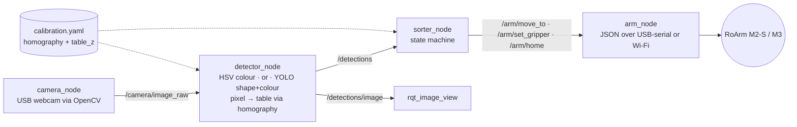

# IntelPick: architecture and assumption check

Goal: a webcam looks down at a table with coloured objects (cubes, bottle caps, 3D-printed
shapes). The system finds each object and a Waveshare RoArm picks it up and drops it into the
bin for its colour or shape.

## 1. Checking the original sketch

Checked 2026-09-23 against the Waveshare wiki, the `waveshareteam/roarm_ws` repo, the Ultralytics
docs, and this machine's WSL2 setup.

| # | Assumption | Verdict | What is actually true / what to do |
|---|---|---|---|
| 1 | "YOLO is ready, no need to train it" | **Partly false** | Pretrained COCO weights have 80 classes; *cube*, *bottle cap* and colour classes are not among them. For this project's colour-recognition goal, fine-tune a detection model with `red`, `green`, `blue`, `yellow` labels. HSV is available as a baseline or a colour recogniser after YOLO localisation. See [YOLO.md](YOLO.md). |
| 2 | "YOLOv8, installed with one command" | **True, with a catch** | `pip install ultralytics` works. The current Ultralytics model is **YOLO26**, with the same API (only the weights name changes); YOLOv8 still works. **Catch:** pip pulls in NumPy 2.x, which breaks ROS Humble's `cv_bridge` (built against NumPy 1.21). Install with `pip install ultralytics "numpy<2"`. Licence is AGPL-3.0: fine for a student project, not for closed commercial use. |
| 3 | "OpenCV, 1 command" | **True, already done** | OpenCV 4.5.4 is installed in WSL for the HSV baseline. Ultralytics brings its own pip dependency; `requirements-yolo.txt` constrains OpenCV and NumPy for ROS Humble compatibility. See the installation check in [YOLO.md](YOLO.md). |
| 4 | "RoArm probably has a ready ROS 2 driver" | **True (M2-S and M3)** | [`waveshareteam/roarm_ws`](https://github.com/waveshareteam/roarm_ws) targets **ROS 2 Humble on Ubuntu 22.04**, exactly what this WSL has. But its XYZ services (`/move_joint_cmd`, …) sit on top of **MoveIt 2**, which is heavy and not installed. This project uses a **thin driver of its own** (`arm_node`) that speaks the arm's documented JSON protocol (`T:104` move to XYZ, `T:105` read position, `T:106` gripper) over USB-serial or Wi-Fi. `roarm_ws` is still useful later for the URDF and RViz. The old RoArm-M1 uses a different protocol. |
| 5 | "Any USB webcam" | **True, but WSL can't see it by default** | WSL2 does not see USB devices until they are forwarded with **usbipd-win** (installed, v5.3.0). The WSL kernel (6.18) includes `uvcvideo` (webcams) and `cp210x` (the M2-S board's CP2102 USB-serial chip, VID:PID `10c4:ea60`), so forwarding will work. USBPcap is installed on this PC, so `usbipd bind` needs `--force`. Use MJPG at 640×480 to keep USB/IP bandwidth low. **Wi-Fi cameras need no usbipd:** `camera:=http://…` or `rtsp://…` works too (phone app for now). The arm can also go over its own Wi-Fi AP (`host:=192.168.4.1`). |
| 6 | "YOLO → ROS 2 passes coordinates → arm" | **Missing a step** | YOLO outputs **pixels**; the arm needs **millimetres in its own frame**. You need a **camera→table calibration** (a homography, since the table is flat). One webcam, no depth camera: this works because every object lies on the same plane. Tool: `ros2 run intelpick calibrate`. |
| 7 | "Little code, libraries do 80%" | **Mostly true** | This draft is ~900 lines of Python, including comments. Most of the real effort goes into things libraries don't do: calibration, HSV tuning under your lighting, grasp heights, reach limits, and the arm blocking the camera while it moves. |
| 8 | "Cheap" | **True** | Webcam + coloured objects + the arm you have. A fixed top-down camera mount (phone holder, desk lamp arm) matters more than camera quality. |

### Risks not in the sketch

- **Grasp geometry (check first on the real arm).** The RoArm-M2-S is 4-DOF (base, shoulder, elbow,
  clamp). XYZ already uses the first three joints, so **the clamp's pitch can't be commanded**: it
  is whatever the inverse kinematics gives for that point. Hence the default `approach: radial`:
  descend a few cm short of the object, then slide outward along the base→object line so the
  object enters the jaws from the side (`intelpick/grasp.py`). `ros2 run intelpick probe_arm`
  moves the clamp to table height at several distances so you can watch; switch to
  `approach: vertical` if it turns out the clamp can come straight down.
- **Object size vs. jaw opening.** The clamp opens up to 135° (1.08 rad) and closes at 3.14 rad.
  Pick cubes/caps that fit with margin (≈2–3 cm). Round caps are easier: orientation doesn't matter.
- **Missed grasps.** Feedback (`T:105`) reports the measured clamp angle. Closing on an object
  stalls the jaws early, so the sorter treats "closed almost fully" as *nothing grabbed*, lifts and
  retries instead of carrying air to the bin (`check_grasp`, `empty_grip_margin`, measured by
  `probe_arm`). The squeeze is limited with `T:107` (`grip_torque`, default 30 %) so a stalled
  servo doesn't overheat.
- **Where objects may lie.** Only inside the area enclosed by the calibration markers (put them on the
  corners of a plain matte mat), inside the reach ring, and in camera view. The detector enforces
  the marker area (`workspace_margin`) and draws it green on `/detections/image`; ignored objects
  get a grey ring. Keep the bins off the mat, or sorted objects get picked again.
- **The arm blocks the view.** The sorter only trusts detections after the arm is home and a stable
  object has been seen for N frames in a row.
- **Lighting.** HSV ranges drift between daylight and lamps. Tune under demo conditions.

## 2. System shape

| Package / file | Role |
|---|---|
| `intelpick_interfaces` | `Detection`, `DetectionArray` msgs; `MoveTo`, `SetGripper` srvs |
| `intelpick/camera_source.py` | Opens USB (V4L2) or network (HTTP/RTSP) cameras; newest frame only, reconnects after Wi-Fi drops |
| `intelpick/camera_node.py` | Camera → `sensor_msgs/Image` |
| `intelpick/detectors/color.py` | HSV masks → blobs (centroid, angle, fill ratio as confidence) |
| `intelpick/detectors/yolo.py` | Local Ultralytics detection model → learned colour labels, HSV colour labels, or combined labels (`red_cube`) |
| `intelpick/detector_node.py` | Runs a backend, maps pixels to the table, drops objects outside the workspace, publishes detections + overlay |
| `intelpick/calibration.py` | Fit / load / apply the pixel → table homography; remembers the image size and the workspace (marker hull) |
| `intelpick/roarm.py` | ROS-free RoArm client (serial / HTTP / dry-run), M2 vs M3 command format |
| `intelpick/arm_node.py` | ROS services around `roarm.py`; metres in ROS, mm on the wire |
| `intelpick/sorter_node.py` | Stable target → hover → descend → grip → lift → bin → release → home |
| `intelpick/tracking.py` | Recent consecutive detections, confidence and full approach/grasp reach checks |
| `intelpick/capture_dataset.py` | Camera capture and manual colour bounding-box annotation |
| `intelpick/dataset.py` | YOLO dataset layout, normalized annotations and pre-training checks |
| `intelpick/train_yolo.py` | Dataset validation and colour-preserving YOLO training |
| `intelpick/grasp.py` | Pick/place step lists shared by the sorter and `grasp_trial`: `radial` (M2-S default) or `vertical`; empty-grip check |
| `intelpick/grasp_trial.py` | Tune the grasp on a known spot: sorter's exact sequence, grip check vs. what you saw, put back |
| `intelpick/probe_arm.py` | Hardware bring-up: link, blocking behaviour, clamp angles, table height, reach |
| `intelpick/calibrate.py` | Interactive tool: click a marker, touch it with the limp arm, SPACE |
| `config/intelpick.yaml` | Every tunable: HSV ranges, ROI, bins, heights, reach, speeds |

Conventions: arm frame per Waveshare docs, origin at the base, **+X forward, +Y left, +Z up**.
ROS topics use **metres**; the JSON protocol uses **millimetres**.

### Where the AI is

1. **Learned colour recognition** → fine-tune a YOLO detection model on `red`, `green`, `blue`,
   `yellow` boxes (`backend: yolo`, `yolo_label_mode: class`). Predictions match the bins directly.
2. **Hybrid** → YOLO finds shapes/objects, HSV recognises colour (`yolo_label_mode: color`).
   `color_class` instead emits `red_cube`, `blue_star`, … for matching combined-label bins.
3. **Baseline** → HSV alone (`backend: color`) while collecting data and calibrating.
4. Future extension: a YOLO OBB model for M3 wrist alignment. The current adapter deliberately
   accepts detection models only; its `angle` is zero.

## 3. Milestones

| # | Milestone | Done when |
|---|---|---|
| M0 | USB into WSL | `/dev/video0` and `/dev/ttyUSB0` visible in Ubuntu |
| M1 | Arm alone | **Done 2026-09-30.** `probe_arm` values in the config; `grasp_trial` (radial, approach_speed 0.05) held 5/5 at 25 cm, 3/3 at (20, 12) cm, 3/3 at 33 cm, grip check right every time |
| M2 | Vision alone | Camera test passed (user confirmed); stable YOLO colour predictions still need trained weights and demo-lighting checks |
| M3 | Calibration | RMS < 5 mm; arm hovers exactly over a detected object |
| M4 | Colour sorting loop | 10 objects sorted unattended; log success rate |
| M5 | YOLO colour model | Capture and annotate → `train_yolo` → held-out validation → `backend:=yolo` sorting by learned colours; code/workflow provided, real dataset and training remain |
| M6 | Demo | Video, success rate, picks/min, slide with this diagram |

## 4. Status (2026-10-17)

Target hardware: **RoArm-M2-S** (confirmed). The M3 code path is kept but secondary.

User-confirmed hardware baseline: motion tests and camera test passed. The measured M2-S
grasp, reach, table height and gripper settings from 2026-09-30 remain in the config.

Verified in WSL without hardware: both ROS packages build (with `PYTHONNOUSERSITE=1` once the
YOLO requirements are installed, see the README); 77 tests pass, covering colour detection,
YOLO result handling and label modes, calibration, dataset checks, stable-target expiry,
approach reach, camera reconnect, grasp recovery and arm encoding. ROS integration tests send
synthetic images through real topics and complete pick-and-place service cycles with the
simulated arm. YOLO predictions in those tests are controlled stand-ins: Ultralytics 8.4 and
a CPU-only PyTorch are installed, but no dataset or trained colour weights exist yet.

Remaining physical/model validation: mount the camera looking down, check the bin positions
on the real arm (only spots in front of it have been tested), tune HSV under demo lighting,
calibrate, run sorting with HSV, then capture and label real images, train YOLO, assess
held-out accuracy per colour and run the same sorting test with `backend:=yolo`.
The implementation and commands for that sequence are in [YOLO.md](YOLO.md).
